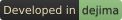

<!-- Fixed, not preference-aware, and that is the decision rather than an
     oversight. `prefers-color-scheme` reports the browser's setting, never the
     site's, and this is read on a forge that renders dark whichever way the
     browser is set - so anything conditional shows dark ink on a dark page to
     a reader whose browser prefers light, and does it silently.
     The suffix names the mode a file is FOR, not the colour of its ink:
     -darkmode is the pale wordmark that belongs on a dark page. GitHub does
     follow its own theme setting through <picture>, so the GitHub mirror
     replaces the tag below with one that falls back to
     dejima-wordmark-lightmode.png; see dejima's mirror/github-mirror.sh.
     Every &nbsp; here is spacing, and it has to be a character rather than CSS
     or a presentation attribute. Gitea's sanitizer strips `style` from the tag
     and from any wrapper, `hspace`/`vspace` survive sanitizing only to be
     ignored by browsers that dropped HTML4 presentation attributes, and a bare
     <br> ends a line nothing follows, which browsers collapse to no height.
     &nbsp; survives as a real U+00A0: on its own line it fills a paragraph
     that would otherwise be empty, and immediately before the tag it sits
     inline and indents the image by one space. -->
&nbsp;

&nbsp;

---

&nbsp;

# dejima-xray

An interactive diagram of what dejima and its sister projects do: which component runs where, which wall bounds it, and where each request is stopped. Turn on a sister project or change a setting and the picture redraws at once. Pick something to happen and a packet walks its real path, with each hop explained.

[](https://gitbox.branderson.io/dejima/dejima)

Settings are named as you would write them (`[core] internal_domains`, `--require-sealed`, `/etc/dejima-ci/pools`). Choices are fixed example values, not free text. The URL carries the current configuration, so a link reproduces the picture.

## Preview

```sh
make serve
```

Then open `http://localhost:8000`. `make check` builds `public/` and fails if anything the page references is missing. `make test` runs the model's tests.

## How it is put together

A static page with no build step and no dependencies.

- `src/config.js`: every setting, with its real name, where it lives, its options, and what it changes. It also holds the launch refusals dejima itself would print.
- `src/topology.js`: `derive(config)` returns the containment tree (zones, machines, VMs, networks, containers, and what runs in them) and the static links between them.
- `src/scenarios.js`: `scenarios(config, derived)` returns what can be played. Each step is a path of node ids and a verdict.
- `src/render.js`: draws the tree as nested elements laid out by CSS, plus an SVG overlay for links and packets.
- `src/main.js`: the settings rail, the scenario player, and the inspector.

The tests in `test/` generate configurations and check that every path and link names something drawn, that a refused packet never reaches its destination, and that refusals match dejima's documented ones.

## Keeping it current

`sources.json` says which release of dejima, and which commit of each sister project, the picture was checked against; the page shows it. [docs/keeping-current.md](docs/keeping-current.md) is the process for each new release: triage the changelog against what is drawn, and verify only the rows a change touched. `make sources` says which pins have fallen behind, and `make unverified` lists the rows nobody has checked yet.

## Addresses

LAN addresses are private-range examples (`10.0.0.0/24`), because dejima's private-address refusal and both hardeners' firewall rules key on private ranges. Public addresses are RFC 5737 documentation addresses.

## Assets

- `assets/` holds the dejima wordmark in both versions (the page uses `-darkmode`), the favicon, and the "Developed in dejima" badge, copied unmodified from the dejima and dejima-badge repositories. The wordmark and favicon are trademarks: see [Licence](#licence).
- `assets/fonts/` holds Latin subsets of Jost, IBM Plex Serif, and JetBrains Mono from [Fontsource](https://fontsource.org), self-hosted. Each is under the SIL Open Font License; the licence files sit beside them.

## Licence

GPL-3.0-or-later, as dejima and darner. See [LICENSE](LICENSE). The settings, refusals, and messages the picture quotes are dejima's and its sister projects', under the same licence.

The dejima wordmark and logo are not code and are not covered by that licence. They are trademarks; who holds them and what may be done with them is stated once for the organisation, at [dejima's ATTRIBUTION.md](https://gitbox.branderson.io/dejima/dejima/src/branch/main/ATTRIBUTION.md).

## Deploy

Served at `xray.dejima.page`, beside the landing page at `dejima.page`, from the same web host and the same way:

```
forge (Gitea), on every push to main
  └─ .gitea/workflows/deploy.yml, on a dejima-confined runner
       1. make check test   build public/, check it, run the tests
       2. upload public/ as the run's `site` artifact

web host, every 5 minutes (deploy/dejima-xray-pull.timer)
  └─ deploy/pull-site.sh
       1. find the newest successful deploy.yml run for a push to main;
          stop if its commit is already live
       2. download its `site` artifact, unpack it into releases/<commit>/,
          refuse it without an index.html
       3. atomically repoint the `current` symlink at it
       4. keep the newest 5 releases

nginx  root = /srv/www/xray.dejima.page/current  (deploy/nginx.conf)
```

The web host pulls rather than CI pushing, because the runner executes agent-authored code and is kept off the network the web host sits on. CI talks only to the forge; the web host talks only to the forge, read-only. Neither holds a credential for the other, and the artifact upload uses the run's own token.

Only a successful run of `deploy.yml` for a push to `main` is deployable: the forge records a run's branch and event, so a workflow on another branch can't produce a build the host will take. Keep `main` protected. A failed download, a wrong token, or an artifact without `index.html` leaves the live release in place.

### Setting it up

This reuses what the landing page's deploy already created: the `site-deploy` forge account and its token, and the `site-deploy` user and `/etc/site-deploy/token` on the web host.

**Forge, once.** Add `site-deploy` to this repository as a collaborator with **read** access. Its token's `read:repository` scope covers every repository the account can read, which is why the account is a collaborator on the deployed sites and nothing else. No new token, and no Actions secret.

**Web host, once.**

```sh
install -d -o site-deploy -g site-deploy -m 755 /srv/www/xray.dejima.page

# Fetch just deploy/. --config-env keeps the token out of argv and out of the
# clone's .git/config. Needs git 2.31+.
export GIT_AUTH="Authorization: token $(cat /etc/site-deploy/token)"
git --config-env=http.extraHeader=GIT_AUTH clone --depth 1 --filter=blob:none --sparse \
    https://gitbox.branderson.io/dejima/xray.git /usr/local/src/dejima-xray
git --config-env=http.extraHeader=GIT_AUTH -C /usr/local/src/dejima-xray sparse-checkout set deploy
unset GIT_AUTH
cd /usr/local/src/dejima-xray

install -m 755 deploy/pull-site.sh /usr/local/bin/pull-dejima-xray.sh
install -m 644 deploy/dejima-xray-pull.service deploy/dejima-xray-pull.timer /etc/systemd/system/
systemctl daemon-reload
systemctl start dejima-xray-pull.service      # first deploy, now; check it worked:
journalctl -u dejima-xray-pull.service -n 20
systemctl enable --now dejima-xray-pull.timer
```

The script and units have their own names, so they sit beside the landing page's `pull-dejima-site.sh` and `dejima-site-pull.*` without touching them. `SITE_FORGE_API` in the service names the forge by its public hostname; if the web host reaches it by another name, override it with `systemctl edit dejima-xray-pull.service` rather than editing the committed file.

Add the directives in `deploy/nginx.conf` to a new `xray.dejima.page` server block inside the host's existing TLS setup, with a certificate for `xray.dejima.page` or `*.dejima.page`, then `nginx -t && systemctl reload nginx`. The `current` symlink is resolved per request, so later deploys need no reload.

`deploy/nginx.conf` lets `dejima.page` embed the site in an iframe and refuses framing by any other origin. An `add_header` in a `location` block replaces the server block's, so if the host adds headers per location, repeat it there.

`pull-site.sh` needs bash, curl, jq, unzip, and coreutils.

To pick up a later change to `deploy/`, update the clone and repeat the two `install` lines and `systemctl daemon-reload`:

```sh
export GIT_AUTH="Authorization: token $(cat /etc/site-deploy/token)"
git --config-env=http.extraHeader=GIT_AUTH -C /usr/local/src/dejima-xray pull --depth 1
unset GIT_AUTH
```

### Checking a deploy

```sh
curl -s -o /dev/null -w "%{http_code}\n" https://xray.dejima.page/
curl -s https://xray.dejima.page/sources.json | jq -r .dejima.release
```

The first prints 200 and the second the dejima release the picture shows. `readlink /srv/www/xray.dejima.page/current` on the host names the commit being served. Then look at it in a browser, on a phone too: the picture can't be judged from status codes.

### Rollback

Releases are kept in `releases/`, each named after the first 12 characters of its commit. To serve an earlier one:

```sh
systemctl stop dejima-xray-pull.timer       # or the next run redeploys main
cd /srv/www/xray.dejima.page
ls -1t releases                             # pick the release to restore
sudo -u site-deploy sh -c 'ln -sfn releases/<id> current.new && mv -T current.new current'
```

That changes what is served, not what is on `main`. Fix or revert the commit on the forge, let CI publish the fix, then `systemctl start dejima-xray-pull.timer` again.
